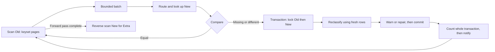

# db-table-fulfill-reconcile-fix

[中文主文档](README.md) · [Verification](VERIFICATION.md) · [Operations](docs/operations.md) · [Contributing](CONTRIBUTING.md)

A Go library for comparing and repairing an old table and a new, optionally sharded, dataset during online migration. **Old is authoritative.** The engine scans Old, looks up matching New rows in batches, then rereads suspected differences under transaction locks before warning or repairing. Rows found only in New are warned about and never deleted.

- Go 1.22+, standard library only in the root module. `mysqltable` uses `database/sql`; applications choose the driver.
- Bounded pages and batches. `MemoryLimit` estimates the current buffered batch, not process RSS.
- Empty, small and uneven shards are supported. See the test evidence and limitations before deploying.

```sh
go get github.com/a52tianshi/db-table-fulfill-reconcile-fix
```

## 0. Five-minute quickstart

Run from the repository root. Use an existing local MySQL server and the `mysql` client; Docker is not required. The following uses a dedicated test database. **The e2e initializer drops and recreates `orders_old` and 100 `orders_new_*` tables in that database.** Passwordless root is for local tests only.

Create the database with one command:

```sh
mysql -u root -e "CREATE DATABASE IF NOT EXISTS reconcile_codex"
```

Build and run concurrent dual writes, three reconciliation passes and independent final verification with one command:

```sh
E2E_MYSQL_DSN="root@tcp(127.0.0.1:3306)/reconcile_codex" DIST=uniform ROWS=2000 USERS=1000 WARMUP=2 GAP=3 ./e2e/run.sh
```

For 2,000 rows, `DIST=uniform` is necessary: the default skew fixtures require at least 27,009 rows. These reduced parameters are for quick validation only; the full script defaults are unchanged. Both 2,000-row uniform and 30,000-row default skew runs obtained `E2E PASS` in this rerun.

Actual terminal excerpt from the uniform run with a writable Go cache:

```text
[verify] old=20829 new=20829 checked=20829 missing=0 different=0 misrouted=0 extra=0 | 123ms
[verify] PASS: old and new tables are identical

E2E PASS
```

The previous run was restricted; database access succeeded in this rerun. The literal 2,000-row command without `DIST=uniform` still fails the existing skew minimum-row constraint. Full commands and actual failure/success output are in [VERIFICATION](VERIFICATION.md). The existing memory-backed example runs without MySQL and asserts missing-row insertion, full-row overwrite and retention of Extra. Separate unit tests verify idempotent second runs:

```sh
go test -count=1 -v -run '^Example$' .
```

Actual output excerpt (timing varies):

```text
=== RUN   Example
--- PASS: Example (0.00s)
PASS
```

If the MySQL client's socket does not match your server, add `-h 127.0.0.1` to the database creation command.

## 1. Workflow and concepts



Old / 老表 is the source of truth; New / 新表 is the target logical dataset. A Finding / 差异 is Missing (Old only), Different (both present, comparator differs) or Extra (New only). A Repair / 修复 inserts Missing or overwrites Different from Old. The idempotency key / 幂等键 is the application's immutable `K`, such as `{OrderID, UserID}`; there is no separate token or durable deduplication registry. Unique database keys, stable routing and transactional rereads allow repeated execution to converge.

`InsertBatchSnapshot` is the explicit exception to rereading before insertion. Missing rows may be inserted with stale scanned values and require a later pass. See the existing [interface contracts](docs/interface-contracts.md) and [state-machine design and implementation boundary](docs/state-machine.md) for details. The detailed design's durable checkpoints and per-key state counters are not implemented.

## 2. Connecting MySQL

The entry point is `reconcile.Run(ctx, cfg)`. **All configuration must be explicit; there are no implicit defaults.** Invalid configuration is rejected before data access, collecting multiple errors. `mysqltable.NewPair` also validates its complete configuration. A compilable example is in [mysqltable/example_test.go](mysqltable/example_test.go).

### Schema and routing

| Schema field | Contract |
|---|---|
| `Columns`, `KeyColumn` | Shared Old/New columns, including the single primary-key column. Column order must match Values and Scan. |
| `Key func(T) K` | Immutable identifier including routing fields when needed. |
| `KeyValue func(K) any` | Typed primary-key value, e.g. int64 or string; never `[]byte`. |
| `KeyLess func(K,K) bool` | Required database primary-key ordering, matching online writers. Account for collation; never sort numeric keys as strings. |
| `Values func(T) []any` | Values in Columns order for INSERT / UPDATE. |
| `Scan func(func(...any) error) (T,error)` | Decode the selected columns in the same order. |

Use `mysqltable.Single[K]("orders_old")`, `mysqltable.Mod("orders_new_%02d", 100, userID)`, `RouterFunc(tables, route)`, or implement `Router[K]` (`Tables` and `Route`). Tables and routes are trusted application configuration.

`PairConfig` requires DB, Schema, Old/New routers, TxOptions, positive InChunk and InsertChunk, and IsDuplicate. All tables must use one `*sql.DB` transaction boundary. READ COMMITTED is recommended; duplicate-key and foreign-key checks may still take gap locks. For example, InChunk=1000 and InsertChunk=500 bound SQL statement sizes. `mysqltable.IsDuplicateKey` recognizes MySQL error 1062.

### Engine configuration

| Field | Meaning |
|---|---|
| `Old`, `New`, `Key`, `Compare` | Pair sources, schema key and comparator. |
| `Policy` | Explicit Missing and Different actions: Warn or Fix. |
| `Insert` | Explicit InsertBatchLocked / InsertBatchSnapshot / InsertPerRow, even in warn-only mode. |
| `ExtraCheck` | CheckExtra enables the reverse pass; SkipExtra cannot establish absence of Extra. |
| `Repairer`, `Notifier`, `Progress` | Pair repairer, notification sink, and synchronous progress callback. Use NoProgress to opt out. |
| `ScanPageSize`, `BatchSize`, `TxBatchSize` | Positive page rows, buffered rows and keys per transaction. mysqltable also groups each engine transaction by one new shard. |
| `MemoryLimit`, `RowSize` | Positive estimated batch bytes require RowSize. NoMemoryLimit requires nil RowSize. An oversized single row is still processed; pages, lookups, driver buffers and findings consume additional memory. |
| `Retry` | Explicit per-step retry policy described below. |

### Retry and progress

Retry requires MaxAttempts ≥ 1 (total attempts), positive Backoff, MaxBackoff ≥ Backoff and a Retryable function. Delay doubles up to MaxBackoff. Each scan page, lookup, transaction and notification is an independent retry step. Exhaustion stops Run with a wrapped error; earlier committed transactions remain committed. `Report.Retries` counts retries.

`mysqltable.IsTransient` recognizes 1213, 1205, 2006, 2013, 1040, bad connections and supported connection-message patterns. Numeric classification currently depends on driver message format. Adapt the classifier when choosing another driver. Context cancellation/deadline and engine invariant failures are not retried. ErrConflict triggers locked rereading instead of ordinary retries; recheck conflicts allow up to three additional rounds.

Transactions rerun from locked rereads, including after an uncertain COMMIT result. Snapshot insertion retries that hit a duplicate fall back to locked rechecking. Data may be correct even when Inserted/Updated counts understate what committed.

Progress is called synchronously after completed batches, at each phase end (`PhaseDone`), and at Run exit (`Done`, with Err on failure). Invalid configuration causes no callback. Public phases are ScanOld and ScanNew. The payload contains phase batch/page counts, cumulative Report and elapsed time. Callbacks block Run and cannot return errors; cancel the context to stop. `LogProgress(writer, interval)` throttles regular messages but always reports phase/Run completion. There is no built-in percentage or durable checkpoint.

## 3. Comparison

| Comparator | Semantics |
|---|---|
| `Exact[T]()` | Uses `==`; avoid for time.Time, whose representation includes location/monotonic state. |
| `Struct[T](ignore, custom...)` | Compares exported top-level fields by value; time.Time uses Equal, nil/empty byte slices are equal. Unknown or promoted embedded field names are rejected. Ignore the entire embedding or use explicit getters. |
| `Fields(...)`, `Eq(name,get)` | Only named fields participate. |
| `Within(name,get,tolerance)` | Overflow-safe int64 tolerance. Negative tolerance panics at construction. |
| `CompareFunc[T]` | Return names of meaningful differing fields; empty means equal. |

Tolerated differences alone trigger no action. If another field triggers Fix, **the whole row is copied, including ignored fields**. Ignore does not mean preserve that target column.

## 4. Policy and insertion modes

Missing=Warn only notifies; Missing=Fix inserts. Different=Warn only notifies; Different=Fix overwrites all non-primary-key columns from Old with single-row UPDATEs. Extra is always warned and retained.

| Mode | Missing-row behavior | Preconditions |
|---|---|---|
| InsertBatchLocked | Lock/reread up to TxBatchSize keys and insert fresh rows in a batch. | Usual transactional contract; recommended starting point. |
| InsertBatchSnapshot | Insert scanned values without rereading. | Old never deletes, Different=Fix, New must not serve reads before convergence in a later successful pass. |
| InsertPerRow | One transaction per missing key. | Useful for diagnosis; more transaction overhead. |

The Chinese README also preserves historical timing examples from [e2e/README.md](e2e/README.md). They are workload-specific prior results, not new measurements or throughput guarantees from this run.

## 5. Online writers and rollout

Online writers must write Old and New in the same transaction and use the same Old-before-New and primary-key lock order. An UPDATE affecting zero rows in New before migration is expected; reconciliation supplies the missing row. Start with Warn, inspect the findings, then enable Fix. Snapshot mode may require later Different repairs.

Before switching reads, require nil Run error, CheckExtra, healthy dual writes, explicit scan boundaries, review of `Consistent()` and repair counts, and independent final validation. A fixed number of clean passes is not proof of global snapshot consistency. See [operations](docs/operations.md) for capacity, stopping, recovery and fault injection.

## 6. Report

| Fields | Interpretation |
|---|---|
| OldScanned / NewScanned | Rows scanned in forward/reverse passes. |
| Suspected / Stale | Initial candidates / candidates equal or absent on fresh reread. |
| Missing / Different / Extra | Confirmed differences; snapshot Missing is based on scanned rows. |
| Inserted / Updated / Warned | Confirmed committed repairs and warn-only decisions. Warned is not a delivery-success count. |
| Retries / Duration | Cumulative retried failures and run time. |
| Consistent() | Only checks that confirmed difference counts are zero. Check error, coverage of Extra and scan scope separately. |

The whole committed transaction is counted before its first notification. A notification failure does not hide later committed rows in that transaction. Uncertain commits followed by rereads can become Stale rather than Inserted/Updated, so repair counters can undercount actual writes.

## 7. Custom adapters

Implement Source.ScanPage (replayable cursor position, bounded pages, each key once per scan) and Source.Lookup (all requested keys resolved; a missing map entry means confirmed absence). Partial results or timeouts must return errors. Typed integer high-water keys avoid BIGINT-to-DOUBLE precision loss.

Repairer.InTx commits only when the callback succeeds and otherwise rolls back; each call makes one attempt. Tx.Lock rereads both sides with compatible lock order. Tx.Insert returns an error wrapping ErrConflict for duplicate keys; Tx.Update copies the Old row. Optional Grouper keeps each transaction within one target group. See [types.go](types.go) and the testing-only [memtable adapter](memtable/memtable.go).

## 8. Failure and concurrency boundaries

The engine runs serially with no background goroutines; completed batches provide backpressure. Failed scans do not judge an unfinished tail batch. Earlier committed transactions survive later failures. New Run calls restart scanning from the beginning.

MySQL high-water marks are per-table primary-key bounds, **not temporal snapshots**. Later inserts below a bound may be seen or missed depending on cursor position. Stable dual writes and final validation remain necessary. Cross-instance transactions require a custom Repairer.

Scan/Lookup/Lock validate physical routing for rows actually read. Wrong-shard data returns an error wrapping mysqltable.ErrMisrouted; errors.As exposes MisroutedError details. IsTransient rejects it. The library neither relocates nor deletes such rows. Unread rows and skipped reverse scans remain outside that guarantee.

Notifications have no durable queue, outbox or replay guarantee. Retries may duplicate events; failure or a later Run may leave events undelivered even when data is repaired. Supply an application persistence/recovery protocol when required. Error classes and actions are listed in [interface contracts](docs/interface-contracts.md).

## 9. Layout and verification

The root contains the engine, interfaces, configuration, comparators, retry, progress, notification and reports. `mysqltable/` supplies routing/schema/SQL adapters; `memtable/` is for tests/examples. `e2e/` is a separate module with a real MySQL driver, concurrent writer and independent verifier.

```sh
./scripts/check.sh all
./scripts/check.sh integration
```

The first runs both modules' build/vet, database-free race tests and lint (gofmt plus shell syntax, not staticcheck). The second requires real MySQL and fails if any test skips. The existing integration tests force the shared database name `reconcile_it` and recreate tables; do not run them concurrently on a shared instance. The quickstart e2e uses the dedicated DSN above.

CI configures Go 1.22.x / 1.25.4 and an isolated MySQL 8.4 service, with the same scripts and a small e2e workload. CI has not been remotely executed during this session. Current measurements, uncovered paths and mock boundaries are in [testing](docs/testing.md) and [VERIFICATION](VERIFICATION.md).

## 10. Release and operations

This work starts from v0.1.0 and is unreleased. Public APIs and data semantics are unchanged; no migration is needed. See [CHANGELOG](CHANGELOG.md) for compatibility/deprecation policy, [SECURITY](SECURITY.md) for reporting and deployment boundaries, [CONTRIBUTING](CONTRIBUTING.md) for checks and [SELF-ASSESS](SELF-ASSESS.md) for scores and unresolved work.

Existing offline demonstrations: [guide](guide.html), [batch scan](batch-scan-demo.html), [single-thread flow](single-thread-state-flow.html), with [maintenance notes](docs/visuals/README.md). They illustrate the design, including capabilities that are explicitly not implemented.
