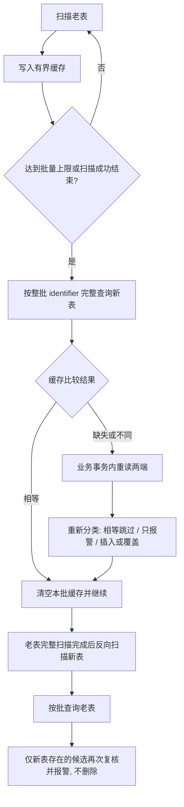

# db-table-fulfill-reconcile-fix

用 Go 编写的可嵌入表数据比对与修复框架。以老表为权威，通过有界批处理发现疑似差异，再由业务在事务内重读两端、复核并决定是否修复。

适用于在线迁移期间的数据校验与补齐。当前为可运行 MVP，尚不是完整的不停机迁移系统；持续并发写入时，单轮扫描不能保证全局收敛。

## 数据处理规则

- 老表有、新表无：复核后插入新表。
- 两边内容不同：复核后以老表覆盖新表。
- 仅新表存在：保留并报警，绝不删除。
- `AlertOnly`：仅复核和报警；`Repair`：允许插入或覆盖。

## 先看运行流程

离线打开 [guide.html](guide.html) 查看流程、分支和事务边界。GitHub 文件页只展示 HTML 源码，下载或克隆后用浏览器打开即可。



每批必须完整查询配对后才能判定疑似缺失；不能因另一张表尚未扫描到某条记录，就认为它不存在。扫描和查询报错立即停止，未完成的尾批不做缺失判断。

## 快速运行

需要 Go 1.22 或更新版本，不依赖第三方库或数据库凭证。

```sh
go run ./cmd/demo
go test -race ./...
go vet ./...
```

内存示例先运行只报警模式，再运行修复模式，展示相等跳过、差异覆盖、缺失插入、额外记录保留。

## 接入自己的数据源

用 `Engine[T, K]` 组合以下接口：

- `Source`：流式扫描及按 key 完整批量查询。
- `Records`：提取稳定唯一 identifier，比较业务内容。
- `Cache`：缓存当前批次；不可静默淘汰。
- `Reviewer`：控制事务边界，重读两端、重新比较、报警和可选修复。

框架不生成 SQL，不绑定 MySQL，也不替业务创建事务。虽然当前两表可以位于同一 MySQL 实例，跨实例部署仍需调用方自行设计一致性协议。

参考 [最小接入示例](cmd/demo/main.go)、[内存事务复核实现](memory/store.go) 与 [完整接口约定及边界说明](docs/interface-contracts.md)。

## 内存、取消和失败处理

核心的缓存、请求 key 和查询结果均为 O(BatchSize)，上限按记录数计算。同步查询及复核阻塞下一批读取，形成背压。数据源和驱动也须自行限制缓冲；内存示例会复制全量 key，仅用于演示，生产适配器应使用有明确快照边界的 keyset 分页。

取消依赖适配器向底层 I/O 传播 context。错误立即返回并支持 `errors.Is`，之前已提交的批次不会回滚。业务复核和告警应支持幂等及安全重试。

## 并发修改限制

事务复核只保护已经发现的候选，不能避免扫描遗漏或比较相等后再次发生修改。生产环境应结合一致性快照或高水位、版本检查、CDC 补偿或定期重跑。真正的不停机迁移还需要全量复制、增量同步、最终校验和切流机制，本 MVP 不包含这些部分。

## 文件导航

- [reconcile.go](reconcile.go)：泛型接口、双向批处理引擎、有界缓存。
- [reconcile_test.go](reconcile_test.go)：8 项关键正确性测试。
- [memory/store.go](memory/store.go)：内存数据源及事务示例。
- [cmd/demo/main.go](cmd/demo/main.go)：可直接运行的示例。
- [guide.html](guide.html)：以流程为主的自包含中文 HTML。
- [docs/interface-contracts.md](docs/interface-contracts.md)：保留的详细 Markdown 说明。
