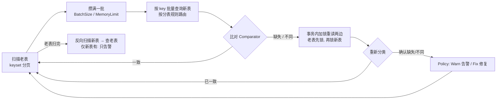

# db-table-fulfill-reconcile-fix

[English mirror](README.en.md) · [验证记录](VERIFICATION.md) · [运维手册](docs/operations.md) · [贡献指南](CONTRIBUTING.md)

老表 → 新表（可分表）在线迁移时使用的 **数据比对与补齐** Go 库。老表是权威数据源。库会扫描老表，按批查询新表做比对；发现疑似差异后，在事务内加锁重读两边，确认确实不一致，再按你的策略 **告警或修复**。只在新表存在的行只告警，永不删除。

- 纯标准库，Go 1.22+；`mysqltable` 只依赖 `database/sql`，用哪个驱动由你决定。
- 分页与批处理有界：`BatchSize` 限制当前批条数，`MemoryLimit` 是当前批的估算字节阈值，不是进程 RSS 上限。
- 支持数据倾斜：空表、不足一页的表、热点表都能正确处理（e2e 有专门覆盖）。

```sh
go get github.com/a52tianshi/db-table-fulfill-reconcile-fix
```

## 0. 五分钟运行 / Quickstart

在仓库根目录执行。需要 Go 1.22+、已运行的本机 MySQL 和 `mysql` 客户端；不需要 Docker。下面使用专用测试库，**e2e 会 DROP 并重建其中的 `orders_old` 与 100 张 `orders_new_*` 表**。无密码 root 仅用于本机测试，正式接入请用最小权限账号。

一条命令建库：

```sh
mysql -u root -e "CREATE DATABASE IF NOT EXISTS reconcile_codex"
```

一条命令构建并运行三轮对账、并发双写与独立最终校验：

```sh
E2E_MYSQL_DSN="root@tcp(127.0.0.1:3306)/reconcile_codex" DIST=uniform ROWS=2000 USERS=1000 WARMUP=2 GAP=3 ./e2e/run.sh
```

小数据必须指定 `DIST=uniform`：默认 `skew` 为覆盖分页边界要求至少 27009 行。缩小参数仅用于快速验证，全量脚本默认值未改。2000 行 uniform 与 30000 行默认 skew 均以 `E2E PASS` 结束。预期输出（行数取决于数据规模）：

```text
[verify] old=<N> new=<N> checked=<N> missing=0 different=0 misrouted=0 extra=0
[verify] PASS: old and new tables are identical

E2E PASS
```

完整命令与输出见 [VERIFICATION.md](VERIFICATION.md)。没有数据库也能运行现有内存示例，验证缺失插入、整行覆盖与 Extra 保留；二次运行幂等性由单测另行验证：

```sh
go test -count=1 -v -run '^Example$' .
```

真实终端输出（耗时会变化）：

```text
=== RUN   Example
--- PASS: Example (0.00s)
PASS
```

MySQL 用 TCP 连接且客户端 socket 不匹配时，建库命令加 `-h 127.0.0.1`。本文后续讲解 API；[概念和错误码](docs/interface-contracts.md#概念表--glossary)、[已实现状态流](docs/state-machine.md#当前实现与设计边界--implementation-status)、[测试口径](docs/testing.md) 可按需查阅。

## 1. 工作流程



除显式选择的 `InsertBatchSnapshot` 外，疑似差异均在事务内加锁重读后再处理；快照插入可能写入扫描时的旧值，必须按后文约定重跑。缺失行可以批量插入；内容不同的行逐条 UPDATE。

## 2. 接入 MySQL：需要填写什么

入口只有一个：`reconcile.Run(ctx, cfg)`。**所有参数都必须填写，没有默认值。** `Run` 在访问任何数据之前先检查整个配置，有问题会一次列出全部，然后直接返回错误。`mysqltable.NewPair(cfg)` 也按同样的规则检查。

完整可编译的示例见 [`mysqltable/example_test.go`](mysqltable/example_test.go)。接入共四步（①–④）；⑤ ⑥ 是 Config 里 `Retry`、`Progress` 两项的详细说明。

### ① Schema：列和结构体的映射

| 字段 | 说明 |
|---|---|
| `Columns` | 参与比对和复制的所有列，顺序与 `Values` / `Scan` 一致，必须包含 `KeyColumn` |
| `KeyColumn` | 单列主键（如 `order_id`），用于 keyset 分页、`IN` 查询、`UPDATE … WHERE` |
| `Key func(T) K` | 行的唯一标识。如果分表依赖其他字段，把它们也放进 K，如 `{OrderID, UserID}`。这些字段必须不可变 |
| `KeyValue func(K) any` | 由 K 取出 `KeyColumn` 的值，必须带类型（int64、string 等），不能是 `[]byte` |
| `KeyLess func(a,b K) bool` | 必填。按 `KeyColumn` 的数据库主键顺序排序，在切分锁定 `IN` 查询之前使用。例如 `a.OrderID < b.OrderID`；不能把整数转成字符串排序。字符串主键须考虑列 collation，并与线上写入方保持同一顺序 |
| `Values func(T) []any` | 按 `Columns` 顺序返回列值（INSERT / UPDATE 使用） |
| `Scan func(scan) (T, error)` | 按 `Columns` 顺序把一行读进 T |

### ② Router：分表规则（老表和新表各一个）

| 构造函数 | 用途 |
|---|---|
| `mysqltable.Single[K]("orders_old")` | 不分表 |
| `mysqltable.Mod("orders_new_%02d", 100, func(k K) int64 { return k.UserID })` | 按 `shardKey % n` 分表 |
| `mysqltable.RouterFunc(tables, route)` | 自定义：给出全部表名和路由函数 |
| 实现 `Router[K]` 接口 | `Tables() []string` 和 `Route(K) string` |

### ③ mysqltable.PairConfig

| 字段 | 示例值 | 说明 |
|---|---|---|
| `DB` | `*sql.DB` | 老表和所有新表都在这一个 MySQL 实例上 |
| `Schema` | 见 ① | |
| `Old` / `New` | 见 ② | |
| `TxOptions` | `&sql.TxOptions{Isolation: sql.LevelReadCommitted}` | 修复事务的隔离级别，推荐 READ COMMITTED（锁定读能读到最新版本；普通搜索不加间隙锁，但外键和重复键检查存在例外） |
| `InChunk` | 1000 | 一条 `IN (...)` 查询最多带多少个 key |
| `InsertChunk` | 500 | 一条多行 INSERT 最多插多少行 |
| `IsDuplicate` | `mysqltable.IsDuplicateKey` | 判断主键冲突（MySQL 错误码 1062） |

### ④ reconcile.Config

| 字段 | 取值 | 说明 |
|---|---|---|
| `Old`, `New` | `pair.Old()`, `pair.New()` | |
| `Key` | `schema.Key` | |
| `Compare` | 见第 3 节 | 比对规则 |
| `Policy` | `{Missing: Warn/Fix, Different: Warn/Fix}` | 每类差异选告警还是修复，见第 4 节 |
| `Insert` | `InsertBatchLocked` / `InsertBatchSnapshot` / `InsertPerRow` | 缺失行的插入方式，见第 4 节。只告警时也必须填 |
| `ExtraCheck` | `CheckExtra` / `SkipExtra` | 是否反向扫描新表，找出只在新表存在的行 |
| `Repairer` | `pair.Repairer()` | |
| `Notifier` | `r.LogNotifier{W: os.Stderr}`（默认只打未修复项；要含已修复行需设 `Fixed: true`）或自己实现 | 先计入整批已提交结果，再逐条回调。回调失败会按 `Retry` 重试并最终停止 Run；通知可能重复或遗漏，无可靠交付保证 |
| `Progress` | `r.LogProgress(os.Stderr, 10*time.Second)` / `r.NoProgress` / 自己的函数 | 进度回调，见 ⑥ |
| `ScanPageSize` | 1000 | 每条扫描 SQL 读多少行 |
| `BatchSize` | 1000 | 攒多少行做一次另一侧的批量查询 |
| `TxBatchSize` | 200 | 一个复核或插入事务最多处理多少个 key。mysqltable 还保证一个事务只涉及一张新分表 |
| `MemoryLimit` | 字节数，或 `r.NoMemoryLimit` | 当前批估算达到阈值就提前处理。扫描页最多 `ScanPageSize` 条，当前批最多 `BatchSize` 条；查询和事务结果另占内存 |
| `RowSize` | `func(T) int64` | 估算每行字节数。`MemoryLimit > 0` 时必填，`NoMemoryLimit` 时必须为 nil |
| `Retry` | 见下表 | 重试策略 |

### ⑤ Retry：每一步都会重试，超过次数整个 Run 退出

扫描每一页、每次批量查询、每个复核或插入事务、每次 Notifier 回调，都是独立的一步，各自按 `Retry` 重试：

| 字段 | 示例值 | 说明 |
|---|---|---|
| `MaxAttempts` | 5 | 每一步最多尝试几次（1 = 不重试） |
| `Backoff` | 50ms | 第一次重试前等多久，之后每次翻倍 |
| `MaxBackoff` | 2s | 等待时间上限 |
| `Retryable` | `mysqltable.IsTransient` | 哪些错误值得重试。`IsTransient` 覆盖死锁、锁等待超时、连接断开等；不建议传 `func(error) bool { return true }`：它会把 `ErrMisrouted`（错片）、`foreign cursor`、通知器配置错误等永久错误一起重试 `MaxAttempts` 次，错片还会反复加 `FOR UPDATE` 锁。需要放宽时用 `func(err error) bool { return mysqltable.IsTransient(err) || errors.Is(err, myErr) }` |

- 某一步超过 `MaxAttempts` 仍然失败，`Run` 立即返回 `scan old page 3: giving up after 5 attempts: <最后一次的错误>`。已提交的事务不回滚，修好问题后重跑即可（幂等）。
- context 取消、引擎自身的不变量错误（例如同一批里出现重复 key）不会重试，直接退出。
- `ErrConflict`（插入时主键冲突）也不按 `Retry` 重试，而是对这些 key 重新加锁复核：首轮之外最多再 3 轮，即最多 4 次锁定复核事务。
- 事务整体重跑：事务内是先加锁重读、再写入，所以即使上次提交结果未知，重跑也是安全的。
- `Report.Retries` 记录了总共重试的次数。

### ⑥ Progress：进度回调

`Progress func(reconcile.Progress)` 在以下时机被**同步**调用：

- 每批处理完之后：这一批已完成查询、事务处理及通知。差异/修复数来自已提交事务；扫描、候选和重试是执行计数。通知失败时，最终回调仍包含整批已提交结果。
- 每个阶段结束时（`PhaseDone=true`）：正向扫描老表结束、反向扫描新表结束。
- Run 结束时调最后一次（`Done=true`）；出错退出时同时带上 `Err`。参数检查失败时不会回调。

| 字段 | 含义 |
|---|---|
| `Phase` | `ScanOld`（扫描老表，找缺失和不同）/ `ScanNew`（扫描新表，找仅新表有的行） |
| `Batch` / `Pages` | 本阶段已完成的批数 / 已扫描的页数 |
| `Report` | 截至此刻的累计数字，字段同第 6 节 |
| `Elapsed` | 已运行时间 |
| `PhaseDone` / `Done` / `Err` | 见上 |

- `r.LogProgress(w, every)`：最多每 `every` 打一行，阶段结束和 Run 结束时一定会打。
- `r.NoProgress`：明确表示不需要进度。
- 回调会阻塞 Run：要推监控或写库的话，回调里只做投递，不要等结果。想中途停止请取消 `ctx`，回调不能中断 Run。
- 没有百分比：引擎不知道总行数。需要的话，用 `information_schema.TABLES.TABLE_ROWS` 的估算值和 `Report.OldScanned` 自己算。

```
reconcile progress phase=old batch=15 pages=15 scanned old=15000 new=0 | missing=15000 different=0 extra=0 | inserted=15000 updated=0 warned=0 | retries=558 | 18s | running
```

## 3. 比对规则：允许部分字段不一致

| 写法 | 含义 |
|---|---|
| `r.Exact[T]()` | 整行 `==` 才算一致。注意：含 `time.Time` 字段时不要用（`==` 会比较时区指针和单调时钟） |
| `r.Struct[T](ignore, custom...)` | **推荐**。比较所有导出字段，`ignore` 中的字段允许不同；`custom` 覆盖某个字段的比较方式。仅支持顶层字段名，拼错或使用匿名嵌入类型的提升字段名会直接报错，不会静默接受。按值比较：`time.Time` 用 `Equal`（同一时刻即相等，不管时区和单调时钟），`[]byte` 中 nil 与空视为相等 |
| `r.Fields(fields...)` | 只比较列出的字段，没列出的都允许不同 |
| `r.Eq(name, get)` | 字段精确相等 |
| `r.Within(name, get, tol)` | 无溢出地比较 int64 差值是否在 ±tol 内；负 tol 在构造时 panic（如时间戳误差 1 秒） |
| `r.CompareFunc[T](func(old, new T) []string)` | 完全自定义：返回不一致的字段名，返回空表示一致 |

只有被容忍的差异时，不会复核、修复或告警。若其他字段触发修复，仍会按策略整行覆盖，包含忽略字段；ignore 不等于“更新时保留此列”。匿名嵌入字段可以整块忽略；要比较提升字段，请使用 `Fields` 配显式 getter。

## 4. 处理策略与插入方式

```go
Policy: r.Policy{Missing: r.Fix, Different: r.Warn}
```

- `Missing`（老表有、新表无）：`Warn` 只告警；`Fix` 插入新表。
- `Different`（两边都有但不一致）：`Warn` 只告警；`Fix` 用老表整行覆盖新表（逐条 UPDATE）。
- `Extra`（只在新表有）：永远只告警，不删除。

`Policy.Missing = Fix` 时，插入方式有三种：

| `Insert` | 做法 | 第一轮补 5 万行耗时 | 注意 |
|---|---|---|---|
| `InsertBatchLocked`（推荐） | 每个事务加锁重读至多 `TxBatchSize` 个 key，再多行 INSERT 最新值 | 7.7s | 一次就写对 |
| `InsertBatchSnapshot` | 直接用扫描时读到的值多行 INSERT，不重读 | 5.5s | 扫描后被改过的行会写成旧值，下一轮会作为 Different 加锁修正。因此 `Missing = Fix` 时必须 `Different = Fix`，否则 `Run` 直接报参数错误。**前提：老表不删除数据**，并且在后续某轮报告 `Consistent()` 之前，新表不能对外提供读 |
| `InsertPerRow` | **初次比对判为 Missing** 的 key 逐条一个事务（比对阶段发现为 Different 的候选仍按 `TxBatchSize` 批量复核） | 53s | 最慢，用于排查 |

耗时是 e2e 默认参数的实测值：页、批都是 1000，事务 200 个 key，8 个写入线程持续双写，不注入故障；本机 Apple M5，MySQL 9.7.1。各模式、各参数组合的完整结果见 [e2e/README.md](e2e/README.md#参考结果)。

## 5. 对线上代码的要求与推荐上线流程

1. **双写**：线上代码在同一个事务里写老表和新表，并且 **先锁老表行，再锁新表行**，与库的加锁顺序一致，避免死锁。如果新表还没有这一行，UPDATE 影响 0 行即可，由本库补齐。
2. **第一轮**：`Missing: Fix`，大量补齐。
3. **第二轮**：用 `InsertBatchSnapshot` 时会修正少量旧值；用其他插入方式时应当没有需要修复的行。
4. **后续轮次**：必须先确认 `err == nil`、启用 `CheckExtra`、双写健康且扫描边界明确，再检查 `rep.Consistent()` 和修复数。切流前还应做独立最终校验；一轮或固定三轮的零统计不是全局一致性证明。
5. 建议先用全 `Warn` 跑一轮，看清差异规模再开启 `Fix`。

## 6. Report 字段

| 字段 | 含义 |
|---|---|
| `OldScanned` / `NewScanned` | 两边扫描的行数 |
| `Suspected` | 第一次（不加锁）比对得到的疑似差异数 |
| `Stale` | 疑似差异中，加锁重读后发现已经一致的数量（线上并发写入导致，属正常） |
| `Missing` / `Different` / `Extra` | 重读后确认的差异数 |
| `Inserted` / `Updated` / `Warned` | 已提交的插入、覆盖，以及确认后选择仅告警策略的行数；`Warned` 不是通知成功投递数 |
| `Retries` | 所有步骤累计重试的次数 |
| `Duration` | 本轮耗时 |
| `Consistent()` | 统计中没有确认差异；必须另查 Run 的 error、是否检查 Extra 和扫描范围，不代表 Run 已成功完成或整库快照一致 |

统计口径说明：

- `InsertBatchSnapshot` 插入的行没有经过重读，它的 `Missing` 是按扫描结果计的。
- 如果事务提交时连接断开、实际却已提交，重跑时这批行会被计为 `Stale`，不计入 `Inserted`。数据是正确的，只是数字偏小。
- 提交已确认成功时，整批差异/修复计数先全部记录；之后即使首条通知失败，Report 与最终 Progress 也不会漏掉同事务后续行。

## 7. 不用 MySQL：自己实现接口

实现下面三个接口即可，具体约定见源码注释（[`types.go`](types.go)）。内存版参考实现见 [`memtable`](memtable/memtable.go)。**每个方法只需尝试一次，重试由引擎统一负责。**

| 接口 | 方法 | 要求 |
|---|---|---|
| `Source[T,K]` | `ScanPage(ctx, cursor, limit)` | 返回 cursor 之后的至多 limit 行，以及下一页的 cursor（nil 表示扫完）。用同一个 cursor 重复调用必须得到同一页的位置；整个扫描中每个 key 恰好出现一次 |
| | `Lookup(ctx, keys)` | 返回存在的行；map 里没有的 key 就表示确认不存在；部分失败必须返回 error |
| `Repairer[T,K]` | `InTx(ctx, fn)` | fn 返回 nil 才提交，任何错误都回滚；只尝试一次，由引擎决定是否重跑整个 `InTx` |
| `Tx[T,K]` | `Lock(ctx, keys)` | 加锁重读两边，先老后新 |
| | `Insert(ctx, rows)` | 多行插入新表；主键冲突时返回包装了 `ErrConflict` 的错误 |
| | `Update(ctx, row)` | 用老表行覆盖新表的同 key 行 |
| `Grouper[K]`（可选） | `Group(K) string` | 同一事务内的 key 属于同一组（如同一分表） |

## 8. 并发与失败

- 引擎串行执行，没有后台 goroutine。一批处理完才读下一批，形成天然背压。
- 每一步失败先按 `Retry` 重试；重试次数用完，或遇到不可重试的错误，`Run` 立即停止。已提交的事务不回滚，重跑是幂等的。
- 扫描失败时，不会处理未满的尾批。
- mysqltable 在每张表扫描开始时记下最大主键上限。这不是时间快照：之后插入但 key 低于上限且在尚未扫描区间的行，仍可能被读到；已过游标的并发插入可能本轮漏读，依赖双写和最终验证。
- mysqltable 扫描和查询均核对每行的实际物理表与路由。错片返回包装 `mysqltable.ErrMisrouted` 的 `*mysqltable.MisroutedError`，包含 key、实际表和期望表；`IsTransient` 不会把它当瞬时错误。数据不移动、不删除，Run 返回错误，已提交的其他批次不回滚。
- Notifier 没有持久化队列或 outbox：失败重试可能重复，停止后未处理 Finding 可能遗漏；再次 Run 不保证重放已经修复的事件。需要可靠交付时由业务提供 outbox/持久化恢复。

## 9. 目录结构与测试

```
.                  核心：types.go 接口 / config.go 参数与校验 / engine.go 引擎 / retry.go 重试 / progress.go 进度 / compare.go 比对 / notify.go / report.go
├── mysqltable/    MySQL 实现：Router 分表规则、Schema、Pair（Source + Repairer）
├── memtable/      内存实现（单测、示例用）
├── e2e/           独立模块：真实 MySQL 端到端测试（1 老表 + 100 分表 + 持续双写）
└── docs/, *.html  设计文档与交互演示
```

```sh
./scripts/check.sh all          # 两个 module 的 build / vet；无 DB race 单测；gofmt 和 shell 语法 lint
./scripts/check.sh integration  # 真实 MySQL 集成；任何 Skip 都视为门禁失败
```

完整 e2e 使用第 0 节的专用 DSN 命令。`mysqltable_it` 会把 DSN 的库名强制改为共享的 `reconcile_it` 并重建测试表，不能靠 DSN 隔离，勿并发执行。CI 在独立 MySQL 8.4 service 上运行相同命令，另跑小规模 e2e；本轮本机可执行结果与尚未验证的版本见 [VERIFICATION.md](VERIFICATION.md)。

## 10. 发布与运维 / Release and operations

- 当前版本为 `v0.3.0`（基线 `v0.1.0`）。公开 API 签名与数据面语义未变，但 `NewPair` 的配置校验加严、冲突错误包装改为 `%w`，升级前请对照 [CHANGELOG 的迁移说明](CHANGELOG.md)。
- [运维手册](docs/operations.md)：权限、双写条件、限流与停止、故障注入、恢复、切流前验证。
- [SECURITY](SECURITY.md)：报告数据损坏与凭据风险；[CONTRIBUTING](CONTRIBUTING.md)：本地与 CI 一致的检查命令。
- [SELF-ASSESS](SELF-ASSESS.md)：六项证据评分、未完成项与自我质疑。验证记录不替代业务自己的容量与恢复演练。

## 设计文档

- [guide.html](guide.html)、[批量扫描演示](batch-scan-demo.html)、[单线程状态流转图](single-thread-state-flow.html)：离线交互演示（[维护说明](docs/visuals/README.md)）。
- [状态机设计稿](docs/state-machine.md)：多表调度、逐 key 状态、检查点等后续设计，尚未实现。进度上报已经有了一个简化版，即 ⑥ 的进度回调。
- [接口约定](docs/interface-contracts.md)：各接口的正确性约定细节。
