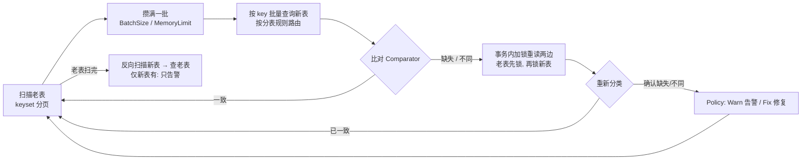

# db-table-fulfill-reconcile-fix

老表 → 新表（可分表）在线迁移时使用的 **数据比对与补齐** Go 库。老表是权威数据源。库会扫描老表，按批查询新表做比对；发现疑似差异后，在事务内加锁重读两边，确认确实不一致，再按你的策略 **告警或修复**。只在新表存在的行只告警，永不删除。

- 纯标准库，Go 1.22+；`mysqltable` 只依赖 `database/sql`，用哪个驱动由你决定。
- 内存有界：按批处理，可同时限制行数（`BatchSize`）和字节数（`MemoryLimit`）。
- 支持数据倾斜：空表、不足一页的表、热点表都能正确处理（e2e 有专门覆盖）。

```sh
go get github.com/a52tianshi/db-table-fulfill-reconcile-fix
```

## 1. 工作流程



疑似差异一律重读后再处理，所以线上并发写入不会让引擎写入过期数据。缺失行可以批量插入；内容不同的行逐条 UPDATE。

## 2. 接入 MySQL：需要填写什么

完整可编译的示例见 [`mysqltable/example_test.go`](mysqltable/example_test.go)。共四步：

### ① Schema：列和结构体的映射（必填）

| 字段 | 说明 |
|---|---|
| `Columns` | 参与比对和复制的所有列，顺序与 `Values` / `Scan` 一致，必须包含 `KeyColumn` |
| `KeyColumn` | 单列主键（如 `order_id`），用于 keyset 分页、`IN` 查询、`UPDATE … WHERE` |
| `Key func(T) K` | 行的唯一标识。如果分表依赖其他字段，把它们也放进 K，如 `{OrderID, UserID}`。这些字段必须不可变 |
| `KeyValue func(K) any` | 由 K 取出 `KeyColumn` 的值 |
| `Values func(T) []any` | 按 `Columns` 顺序返回列值（INSERT / UPDATE 使用） |
| `Scan func(scan) (T, error)` | 按 `Columns` 顺序把一行读进 T |

### ② Router：分表规则（必填，老表和新表各一个）

| 构造函数 | 用途 |
|---|---|
| `mysqltable.Single[K]("orders_old")` | 不分表 |
| `mysqltable.Mod("orders_new_%02d", 100, func(k K) int64 { return k.UserID })` | 按 `shardKey % n` 分表 |
| `mysqltable.RouterFunc(tables, route)` | 自定义：给出全部表名和路由函数 |
| 实现 `Router[K]` 接口 | `Tables() []string` 和 `Route(K) string` |

### ③ Options：适配器参数（都可不填）

| 字段 | 默认值 | 说明 |
|---|---|---|
| `PageSize` | 1000 | 每条扫描 SQL 读多少行，也是每条 `IN` 查询的最大 key 数 |
| `InsertChunk` | 500 | 一条多行 INSERT 最多插多少行 |
| `TxOptions` | READ COMMITTED | 修复事务的隔离级别（避免间隙锁） |
| `MaxRetries` | 10 | 遇到死锁或锁等待超时时，事务的重试次数 |
| `IsRetryable` / `IsDuplicate` | 按 MySQL 错误码 1213、1205 / 1062 匹配 | 按 go-sql-driver 的错误信息格式判断，换驱动时请传入自己的判断函数 |

### ④ Config：引擎参数

| 字段 | 必填 | 默认值 | 说明 |
|---|---|---|---|
| `Old`, `New` | ✓ | | `pair.Old()`, `pair.New()` |
| `Key` | ✓ | | 一般直接用 `schema.Key` |
| `Compare` | ✓ | | 比对规则，见第 3 节 |
| `Repairer` | ✓ | | `pair.Repairer()` |
| `Policy` | | 全部 Warn | 每类差异选告警（`Warn`）还是修复（`Fix`），见第 4 节 |
| `Insert` | | `InsertBatchLocked` | 缺失行的插入方式，见第 4 节 |
| `Notifier` | | 告警输出到 stderr | 每条确认的差异都会在事务提交后回调（包括已修复的） |
| `BatchSize` | | 1000 | 攒多少行做一次新表批量查询 |
| `TxBatchSize` | | 200 | 一个复核或插入事务最多处理多少个 key。mysqltable 还保证一个事务只涉及一张新分表 |
| `MemoryLimit` + `RowSize` | | 0（不限） | 按字节限制内存。缓存的行达到上限会提前处理当前批，需要提供 `RowSize` 估算每行大小 |
| `SkipExtraCheck` | | false | 跳过反向扫描（不检查仅新表存在的行，可以省一次新表全量扫描） |

`engine.Run(ctx)` 返回 `Report`，各字段见第 6 节。

## 3. 比对规则：允许部分字段不一致

| 写法 | 含义 |
|---|---|
| `r.Exact[T]()` | 整行 `==` 才算一致 |
| `r.Struct[T](ignore, custom...)` | **推荐**。比较所有导出字段，`ignore` 中的字段允许不同；`custom` 覆盖某个字段的比较方式。字段名拼错会直接报错，不会悄悄漏比 |
| `r.Fields(fields...)` | 只比较列出的字段，没列出的都允许不同 |
| `r.Eq(name, get)` | 字段精确相等 |
| `r.Within(name, get, tol)` | 数值差在 ±tol 以内视为一致（如时间戳误差 1 秒） |
| `r.CompareFunc[T](func(old, new T) []string)` | 完全自定义：返回不一致的字段名，返回空表示一致 |

被容忍的差异不算疑似差异：不会复核、不会修复、也不会告警。

## 4. 处理策略与插入方式

```go
Policy: r.Policy{Missing: r.Fix, Different: r.Warn}
```

- `Missing`（老表有、新表无）：`Warn` 只告警；`Fix` 插入新表。
- `Different`（两边都有但不一致）：`Warn` 只告警；`Fix` 用老表整行覆盖新表（逐条 UPDATE）。
- `Extra`（只在新表有）：永远只告警，不删除。

`Policy.Missing = Fix` 时，插入方式有三种：

| `Insert` | 做法 | 速度（e2e 5 万行） | 注意 |
|---|---|---|---|
| `InsertBatchLocked`（默认） | 每个事务加锁重读至多 `TxBatchSize` 个 key，再多行 INSERT 最新值 | 7.0s | 一次就写对 |
| `InsertBatchSnapshot` | 直接用扫描时读到的值多行 INSERT，不重读 | 5.0s | 扫描后被改过的行会写成旧值，下一轮会作为 Different 加锁修正（需 `Different = Fix`）。**前提：老表不删除数据**，并且在后续某轮报告 `Consistent()` 之前，新表不能对外提供读 |
| `InsertPerRow` | 每个 key 一个事务 | 64s | 最慢，用于排查 |

## 5. 对线上代码的要求与推荐上线流程

1. **双写**：线上代码在同一个事务里写老表和新表，并且 **先锁老表行，再锁新表行**，与库的加锁顺序一致，避免死锁。如果新表还没有这一行，UPDATE 影响 0 行即可，由本库补齐。
2. **第一轮**：`Missing: Fix`，大量补齐。
3. **第二轮**：用 `InsertBatchSnapshot` 时会修正少量旧值；用其他插入方式时应当没有需要修复的行。
4. **第三轮**：`rep.Consistent()` 为 true，且 `Inserted`、`Updated` 都为 0，说明已经收敛。之后才能切读或切流。
5. 建议先用全 `Warn` 跑一轮，看清差异规模再开启 `Fix`。

## 6. Report 字段

| 字段 | 含义 |
|---|---|
| `OldScanned` / `NewScanned` | 两边扫描的行数 |
| `Suspected` | 第一次（不加锁）比对得到的疑似差异数 |
| `Stale` | 疑似差异中，加锁重读后发现已经一致的数量（线上并发写入导致，属正常） |
| `Missing` / `Different` / `Extra` | 重读后确认的差异数 |
| `Inserted` / `Updated` / `Warned` | 实际插入、覆盖、仅告警的行数 |
| `Consistent()` | 本轮没有确认任何差异 |

## 7. 不用 MySQL：自己实现接口

实现下面三个接口即可，具体约定见源码注释（[`types.go`](types.go)）。内存版参考实现见 [`memtable`](memtable/memtable.go)。

| 接口 | 方法 | 要求 |
|---|---|---|
| `Source[T,K]` | `Scan(ctx, yield)` | 每个 key 恰好产出一次，同步调用 yield，完整遍历才返回 nil |
| | `Lookup(ctx, keys)` | 返回存在的行；map 里没有的 key 就表示确认不存在；部分失败必须返回 error |
| `Repairer[T,K]` | `InTx(ctx, fn)` | fn 返回 nil 才提交；可以重试 fn |
| `Tx[T,K]` | `Lock(ctx, keys)` | 加锁重读两边，先老后新 |
| | `Insert(ctx, rows)` | 多行插入新表，主键冲突返回 `ErrConflict` |
| | `Update(ctx, row)` | 用老表行覆盖新表的同 key 行 |
| `Grouper[K]`（可选） | `Group(K) string` | 同一事务内的 key 属于同一组（如同一分表） |

## 8. 并发与失败

- 引擎串行执行，没有后台 goroutine。一批处理完才读下一批，形成天然背压。
- 任何错误都会立即停止 `Run`，已提交的事务不回滚。重跑是幂等的。
- 扫描失败时，不会处理未满的尾批。
- 每张表扫描开始时会记下当前最大主键作为扫描上限，之后新插入的行留给双写保证。持续写入下，单轮不保证全局一致，需要多轮收敛（见第 5 节）。

## 9. 目录结构与测试

```
.                  核心：types.go 接口 / config.go 参数 / engine.go 引擎 / compare.go 比对 / notify.go / report.go
├── mysqltable/    MySQL 实现：Router 分表规则、Schema、Pair（Source + Repairer）
├── memtable/      内存实现（单测、示例用）
├── e2e/           独立模块：真实 MySQL 端到端测试（1 老表 + 100 分表 + 持续双写）
└── docs/, *.html  设计文档与交互演示
```

```sh
go test -race ./...      # 单测：engine_test / compare_test / memtable / mysqltable（不需要数据库）
cd e2e && ./run.sh       # 端到端测试：需要本机 MySQL，详见 e2e/README.md
```

## 设计文档

- [guide.html](guide.html)、[批量扫描演示](batch-scan-demo.html)、[单线程状态流转图](single-thread-state-flow.html)：离线交互演示（[维护说明](docs/visuals/README.md)）。
- [状态机设计稿](docs/state-machine.md)：多表调度、进度上报、检查点等后续设计，尚未实现。
- [接口约定](docs/interface-contracts.md)：各接口的正确性约定细节。
