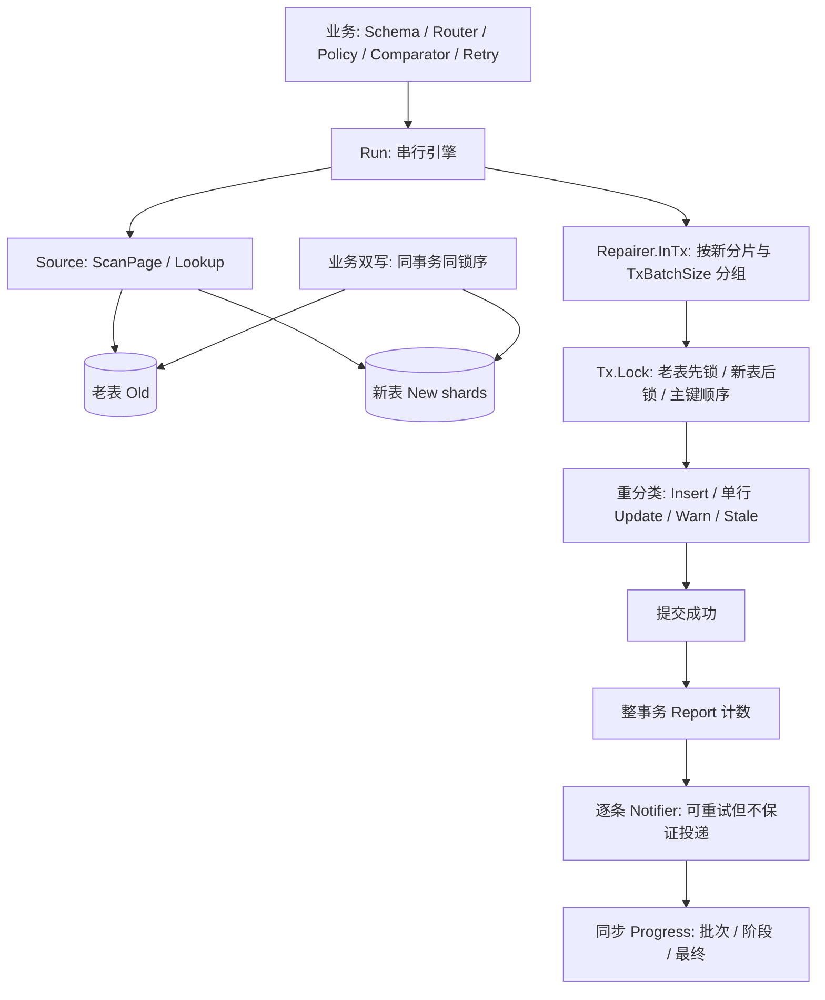

# 接口约定与正确性边界

使用方式见 [README](../README.md)；本文说明实现自定义 `Source` / `Repairer` 时必须遵守的约定，以及引擎能保证与不能保证的事情。

## Source

- 每个方法只尝试一次，重试由引擎按 `Config.Retry` 统一负责。
- `ScanPage(ctx, cursor, limit)` 返回至多 limit 行，以及下一页的 cursor（nil 表示扫完）。某一页可以为空而 cursor 不为 nil（例如遇到空分表）。用同一个 cursor 重复调用必须回到同一位置，因为重试依赖这一点。
- 每个 key 在一次完整扫描中恰好出现一次。引擎只检测同一批内的重复，不维护全量 seen 集合（否则内存无界）。
- 生产实现应使用主键 keyset 分页（`WHERE k > ? ORDER BY k LIMIT n`），不要用 OFFSET（并发插入会漏读或重复）。
- 用整型主键做扫描上限时，要传入带类型的值：MySQL 把字符串和 BIGINT 比较时会转成 DOUBLE，雪花 ID 会因此丢精度。
- `Lookup` 必须解析所有请求的 key。map 里没有某个 key，就表示确认不存在；超时、分页未读完、部分失败都必须返回 error。引擎会校验返回的 key 都是请求过的，且 `Key(row)` 与之一致。

## Repairer / Tx

- `InTx` 在 fn 返回 nil 时提交，任何错误都回滚。只做一次尝试；引擎遇到可重试错误时会重跑整个 `InTx`。每次重跑都重新收集结果，只在提交成功后才计数和回调 Notifier。提交结果未知时（例如连接在 COMMIT 时断开）重跑也是安全的：重跑时先加锁重读，已经插入的行会被识别为已一致。**`InsertBatchSnapshot` 是例外**：它重试时直接再发一次无锁 `INSERT`，靠第二次插入返回 1062（`ErrConflict`，不计入 `Report.Retries`）才转入锁定复核；因此该模式下丢应答会放大成 3 个事务；这批写入最终按 `Stale` 计入，`Inserted`/`Updated` 会偏小（`Consistent()` 不受影响，因为它只判断是否还有待修复差异），且自定义 `Repairer.Tx.Insert` 若实现成 upsert（`REPLACE` / `INSERT IGNORE`）或目标表没有唯一键，重试会静默覆盖新值或重复写入。
- `Lock` 加锁重读两边，**先锁老表，再锁新表**，每侧都先按 `Schema.KeyLess` 对同物理表的全部请求 key 排序，再切分 `IN` 查询加锁。线上双写必须遵守相同的顺序，否则可能死锁。
- 隔离级别建议用 READ COMMITTED：普通锁定搜索不加间隙锁并能读到最新已提交版本；外键和重复键检查仍可能使用间隙锁，仍需处理死锁。
- `Insert` 遇到主键冲突时，返回的错误要包装 `ErrConflict`。引擎收到后会对这些 key 重新加锁复核（最多 3 次）。
- `Update` 用老表整行覆盖新表。老表和新表的结构必须相同。
- 引擎从不删除新表的行。

## 引擎保证

- 任何写入都基于加锁重读后的最新状态，只有 `InsertBatchSnapshot` 例外（见下文）。
- 查询或扫描失败，绝不会被当成数据缺失。扫描失败时不处理未满的尾批。
- 扫描页最多 `ScanPageSize` 行、当前缓存批最多 `BatchSize` 行；Lookup、事务重读、Finding 和驱动另占内存，`MemoryLimit` 仅是当前缓存批的 RowSize 估算阈值，不是 RSS 硬上限，单行超限仍可被处理；单个事务最多 `TxBatchSize` 个 key。
- 串行执行，处理完一批才读下一批。
- 每一步（扫描一页、批量查询、事务、Notify）独立重试。超过 `MaxAttempts` 次，或遇到不可重试的错误，`Run` 立即返回，并保留 `errors.Is` 链。已提交的事务不回滚，重跑是幂等的。
- 配置全部必填；`Run` 在访问任何数据之前先完成参数检查。

## Progress

- 同步调用：每批处理完（复核和写入都已提交）一次、每个阶段结束一次（`PhaseDone`）、Run 结束一次（`Done`，出错时带 `Err`）。参数检查失败时不调用。
- 回调没有返回值，不能中断 Run；要停止请取消 ctx。回调耗时直接计入 Run 的耗时。

## InsertBatchSnapshot 的边界

它直接用扫描时读到的值插入。如果某行在扫描之后被更新，而此时新表还没有这一行，线上双写的 UPDATE 会影响 0 行，于是旧值被插入新表。下一轮会把它识别为 Different，并在加锁后修正，因此需要 `Different = Fix` 并多跑一轮。

前提是老表不删除数据：被删除的行如果以旧值插入新表，之后只会被报为 Extra，引擎不会删除，因而永远收敛不了。

## 不能保证的

- 持续并发写入下，单轮扫描不保证全局一致。`Consistent()` 只检查已统计差异是否为零，必须另查 error、CheckExtra、双写健康、扫描边界及独立最终校验，不能单独作为切流依据。
- 主键高于高水位的新增行不进入本轮；低于上限的新插入行可能被纳入，也可能因已过游标而本轮漏读。高水位不是时间快照，仍依赖双写。
- 跨实例分表：mysqltable 假设所有表在同一个 `*sql.DB` 上，一个事务可以同时覆盖老表和新表。跨实例部署需要自己实现 Repairer（例如版本条件写入）。
- 告警投递：先统计整个已提交事务，再逐条调用 Notifier；同一事务首条通知失败不会漏计后续已提交行。`Warned` 是选择只告警策略的条数，不是投递成功数。没有 outbox 或持久化待投递队列，所以可能重复，也可能遗漏；再次 Run 不保证补发已经修复的 Finding。可靠投递由业务实现。
- 计数精确度：提交结果未知时会重跑事务，这批已提交的行会被计为 `Stale`，`Inserted` / `Updated` 因此可能偏小，数据本身是正确的。

## MySQL 物理路由与锁序

- `Schema.KeyLess` 必填，按主键的数据库顺序比较，且与线上写入者一致。整数不可转字符串排序；字符串主键须考虑 collation。适配器不会猜测 `KeyValue(any)` 的排序方式。
- ScanPage 在读取高水位行和页数据后、Lookup/Lock 在取回行后，验证该行的 Route(key) 与当前物理表一致。错片返回可用 errors.Is 检查的 `mysqltable.ErrMisrouted`，errors.As 可取得 `*MisroutedError` 的 Key/Table/Expected。
- 适配器不会移动或删除错片数据；错误停止 Run，不将该记录当 Stale 或成功一致。检测只覆盖实际读取的范围；SkipExtra、扫描边界或未读取的数据仍不能作全库路由正确性保证。

## 比较器配置

- `Within` 使用无符号差值幅度，支持完整 int64 边界，不会有符号减法溢出。负 tolerance 在构造时 panic。
- `Struct` 的 ignore/custom 名称仅允许顶层字段；匿名嵌入的提升字段明确报错，包含指针嵌入。可忽略整个嵌入，或改用 Fields 显式 getter。
- 比较容忍不改变 Update 的整行覆盖语义：其他字段触发修复时，忽略字段也会被复制。

## 概念表 / Glossary

| 中文 / English | 定义与责任 |
|---|---|
| 老表 / Old, source of truth | 权威数据源，既可以是单表也可以路由到多张物理表。修复不会写老表。 |
| 新表 / New, target | 迁移后的逻辑数据集；`Router` 把不可变 key 映射到一张物理分表。 |
| 差异 / Finding | `Missing` 老有新无、`Different` 两端有且比较器不一致、`Extra` 仅新有。`Suspected` 只是候选，不能当作已确认差异。 |
| 修复 / Repair | `Missing=Fix` 插入；`Different=Fix` 按老表整行覆盖；`Extra` 永远保留并告警。提交完成才计修复数。 |
| 幂等键 / Idempotency key | 业务传入的不可变 `K`，例如 `{OrderID, UserID}`。不是库另造的 token，也不是持久化去重表。数据库唯一主键、路由不变、事务重读共同使重复执行收敛。 |
| 扫描游标 / Cursor | Source 私有的内存位置，不是可持久化检查点。每次 Run 重新扫描。 |
| 高水位 / High-water key | 每张物理表扫描开始时读到的最大主键；不是全局一致性快照。 |

## 架构与数据流 / Architecture and data flow

正向数据流为：读老表页 → 有界缓存批 → 路由查询新表 → 内存比较 → 候选按分片拆事务 → 锁定重读 → 分类写入 → 提交 → 计数 → 通知。反向读新表，只将老表查不到的候选送入复核。快照插入是显式例外：扫描行直接入事务 INSERT，冲突才退回锁定复核。

库不负责连接池大小、业务双写、任务互斥、检查点、通知 outbox 或跨实例原子性。`memtable` 只用于测试和示例；`mysqltable` 通过 `database/sql`，不捆绑驱动。

## 错误码与处置 / Error classification

以下是现有可观察错误分类，**不是新增字符串错误码 API**。优先检查 `errors.Is` / `errors.As`，不要匹配完整错误文案。MySQL 数字码识别目前依赖驱动消息格式，其他驱动须提供适合自己的分类器。

| 类别 / Code | 检测方式 | 引擎行为与处理 |
|---|---|---|
| 配置错误 / Invalid config | `Run` / `NewPair` 返回聚合错误，尚无导出 sentinel | 不访问数据；修复全部必填项。比较器构造也可能返回错误，`Within` 负容差会 panic。 |
| 取消 / Canceled, deadline | `errors.Is(err, context.Canceled/DeadlineExceeded)` | 不重试；保留之前已提交事务。恢复后新建 ctx 重跑。 |
| 写竞争 / Conflict, MySQL 1062 | `errors.Is(err, reconcile.ErrConflict)` | 不按 Retry 原样重试；快照插入转锁定复核，复核冲突最多追加 3 轮；持续竞争返回错误。 |
| 错片 / Misrouted | `errors.Is(err, mysqltable.ErrMisrouted)`，`errors.As` 获取 `*MisroutedError` | `IsTransient` 判为不可重试；停止，人工核对路由及落片，库不移动或删除行。 |
| 瞬时 / 1213, 1205, 2006, 2013, 1040 | `mysqltable.IsTransient(err)` | 受 MaxAttempts 和退避上限约束；整事务重试，重读当前行。 |
| 连接异常 / Bad connection | `driver.ErrBadConn`、`sql.ErrConnDone` 及现有消息分类 | 同上；COMMIT 响应丢失不等于回滚，修复计数可能偏小。 |
| 数据契约破坏 / Invariant | 重复扫描 key、Lookup/Lock 返回非请求 key 等错误 | 停止；事务内契约错误不因 Retryable=true 而重试。不要通过忽略错误继续切流。 |
| 通知失败 / Notify error | 返回错误保留 `errors.Is` 链；操作前缀为 `notify` | 已提交数据保持；按 Retry 处理，耗尽停止。需要可靠事件时外置持久化投递方案。 |

### Error classification (English)

For on-call readers: this table is the same classification as above, in English. These are *existing* observable categories, not a new string-code API. Always branch on `errors.Is` / `errors.As`, never on the full message. Numeric MySQL codes are recognised from the driver message; other drivers must supply their own classifier.

| Category | Detection | Engine behaviour / action |
|---|---|---|
| Invalid config | `Run` / `NewPair` return an aggregated error (no exported sentinel yet) | No data access. Fix the required fields. Comparators may also fail; a negative `Within` tolerance panics. |
| Canceled / deadline | `errors.Is(err, context.Canceled)` or `context.DeadlineExceeded` | Not retried. Transactions already committed stay committed. Rerun with a fresh context. |
| Write conflict (MySQL 1062) | `errors.Is(err, reconcile.ErrConflict)` | Not retried as-is; snapshot insert falls back to a locking recheck, at most 3 extra rounds; persistent contention returns an error. |
| Misrouted row | `errors.Is(err, mysqltable.ErrMisrouted)`; `errors.As` yields `*MisroutedError` | `IsTransient` reports it as permanent. Stop and check routing/sharding manually; the library never moves or deletes rows. |
| Transient (1213, 1205, 2006, 2013, 1040) | `mysqltable.IsTransient(err)` | Retried within `MaxAttempts` and the backoff cap; the whole transaction reruns and rereads. |
| Bad connection | `driver.ErrBadConn`, `sql.ErrConnDone`, plus the message classifier | Same as above. A lost COMMIT ack is not a rollback; repair counters may under-count. |
| Invariant broken | Re-scanned keys, Lookup/Lock returning unrequested keys, etc. | Stop. Contract violations inside a transaction are never retried, even with `Retryable: return true`. Do not cut traffic over by ignoring the error. |
| Notify failure | Error keeps its `errors.Is` chain; step prefix is `notify` | Committed data stays. Handled by the Retry policy, then stops when exhausted. Use an outbox for reliable events. |

排障和恢复步骤见 [运维手册](operations.md)，测试证据和未覆盖的物理故障见 [测试口径](testing.md)。
